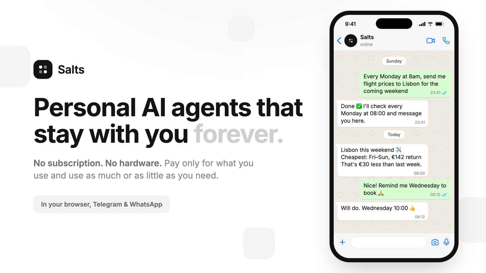

<p align="center">
  <a href="https://salts.dev"></a>
</p>

<h1 align="center">Salts</h1>

<p align="center">
  <b>Personal AI agents that stay with you forever.</b><br>
  In your browser, on Telegram and on WhatsApp. $0 while idle, a few cents per reply.
</p>

<p align="center">
  <a href="https://github.com/AlwaysHungrie/salts-agent/blob/main/LICENSE"></a>
  <a href="https://github.com/AlwaysHungrie/salts-agent/stargazers"></a>
  <a href="https://x.com/saltsdotdev"></a>
  <a href="https://t.me/+ErLH1BA0hHUzZGM1"></a>
</p>

<p align="center">
  <a href="https://app.salts.dev">Get an agent</a> •
  <a href="https://salts.dev/guide">User guide</a> •
  <a href="https://salts.dev/guide/api-playground">API</a> •
  <a href="docs/architecture.md">Architecture</a> •
  <a href="docs/development.md">Self-host</a>
</p>

<p align="center">
  
</p>

## What it is

Salts gives you an AI agent of your own. You message it like a friend, it remembers what
you tell it, and it messages you back when something is due. Each agent runs in the
cloud, costs nothing while nobody is talking to it, and bills you per message on your own
OpenRouter key: about $0.001 a reply on small models, up to $0.03 on the largest.

- **Talk to it anywhere.** Web chat, a Telegram bot, a WhatsApp number. Text, links,
  photos and voice notes in; text and voice notes out.
- **It remembers and reminds.** Memory across sessions, scheduled tasks, "every Monday
  at 8am, send me…".
- **Every capability is a switch.** Web search, reading links and PDFs, image input,
  image generation, voice, spreadsheets, Notion, GitHub. Turn on what you need.
- **Bring your own tools.** Connect any MCP server, or run local ones from your laptop
  with [`salts-tools`](salts-tools/).
- **Any model.** Pick from the OpenRouter catalogue and switch per agent.
- **Share it.** Add it to a Telegram group and choose exactly who it answers.
- **Fleets.** Create agents for a whole community on one shared key, with a spend limit
  per person. Members' conversations stay private to them.
- **An API.** Every agent can be reached from your own code with an API key.
  ([playground](https://salts.dev/guide/api-playground))
- **You see every cent.** Tokens and dollar cost on every reply, as it streams.

## Quick start

**Hosted:** sign in at [app.salts.dev](https://app.salts.dev), add an OpenRouter key
(from [openrouter.ai](https://openrouter.ai), or buy one with a crypto wallet in the
app), create an agent. Takes a few minutes; the
[step-by-step guide](https://salts.dev/guide/step-by-step-agent) walks through it.

**Run it yourself:**

```bash
git clone https://github.com/AlwaysHungrie/salts-agent && cd salts-agent

# terminal 1: the agent
cd agent && npm install && npm run dev               # http://localhost:8787

# terminal 2: default settings (once), then the web app
cd admin-cli && npm install && npm run init -- --dev
cd ../frontend && pnpm install && pnpm dev           # http://localhost:3000
```

Each agent needs its own OpenRouter key; there is no shared one. Sign-in uses Clerk.
[docs/development.md](docs/development.md) covers the env files, deployment settings and
deploying to your own Cloudflare account, which also lifts the hosted usage limits.

## How it works

Every agent and every chat session is a Cloudflare Durable Object with its own SQLite
database. An agent that nobody is messaging is asleep and costs nothing; a message wakes
it, it calls the model, replies, and goes back to sleep. Cloudflare's share is about
$0.00005 a message ([measured](docs/cloudflare-durable-object-costs.md)); the rest is the
model, billed to your key at OpenRouter's price with no markup.

```
agent/         Cloudflare Worker + Durable Objects: the agent itself
frontend/      Next.js web app: chat, settings, capabilities, fleets, the user guide
landing-page/  Next.js site at salts.dev
admin-cli/     Owner dashboard: users, limits, deployment settings
salts-tools/   Laptop CLI: local services and MCP servers behind one tunnel
local-mcps/    MCP servers salts-tools runs
```

[docs/architecture.md](docs/architecture.md) explains it from scratch: what each Durable
Object owns and how a message travels end to end.

## Community

- Questions and ideas: [Telegram](https://t.me/+ErLH1BA0hHUzZGM1)
- Bugs: [GitHub issues](https://github.com/AlwaysHungrie/salts-agent/issues/new)
- News: [@saltsdotdev](https://x.com/saltsdotdev)

Pull requests are welcome. Start with [docs/development.md](docs/development.md); new
behaviour lands with tests.

## License

[Apache 2.0](LICENSE).
